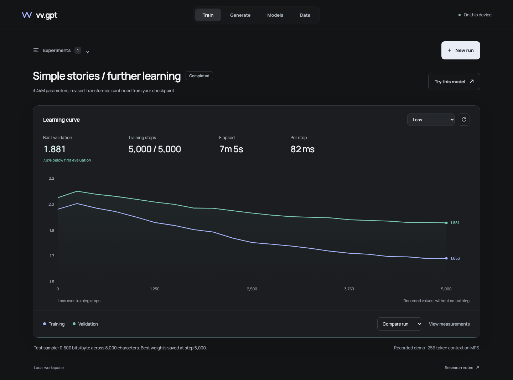

# VV-GPT · A local language-model studio

**Train a small Transformer, watch it learn, and test the weights you made.**

VV-GPT4 is Xavier Blake's continuation of [VV-GPT3](https://github.com/XavierB100/vv-gpt3): a local research workspace for building language models from scratch and improving existing checkpoints. PyTorch handles the models; a Flask app makes training, comparison and generation visible in a quiet, dark interface.



[Portfolio case study](docs/CASE_STUDY.md) · [Screenshot gallery](docs/GALLERY.md) · [Quick walkthrough](docs/USER_GUIDE.md) · [Results and limitations](docs/RESULTS.md) · [Download release](https://github.com/XavierB100/vv-gpt4/releases/tag/v4.3.0)

## What it does

- **Train your own models.** Original-compatible Transformer blocks or a revised RMSNorm / RoPE / SwiGLU decoder; configurable size, vocabulary, context and training budget.
- **Build on existing weights.** Continue a copy of an original or newly trained model. The source stays intact, and continuation must beat its starting validation score to replace the best weights.
- **See the experiment.** Live, unsmoothed train/validation curves, timing, held-out scores, side-by-side run comparisons and a table of every evaluation.
- **Make training durable.** Separate atomic best/latest checkpoints, optimizer and RNG recovery, pause, stop, resume and early stopping.
- **Inspect generation.** Seeded sampling, matched model comparisons, optional repetition controls and saved outputs with their settings.
- **Keep the workspace local.** No API key or external inference provider. Raw imports, datasets, models and samples stay in ignored local storage.

This is a small-model research project. Generation continues a prompt; it is **not a general-purpose instruction-following assistant**. The optional demo weights were trained in this project from random initialization, using public story text. GPT-2 vocabulary support uses its tokenizer only, not pretrained GPT-2 model weights.

## Run it

Python **3.11** is the tested version. macOS with Apple Silicon uses MPS; other installations select CUDA when available, then CPU. CPU training is slower. Allow several GB for Python dependencies and additional space for datasets/checkpoints; Linux CUDA packages can be substantially larger. Node is needed only for optional browser tests.

```sh
git clone https://github.com/XavierB100/vv-gpt4.git
cd vv-gpt4
python3.11 -m venv .venv
source .venv/bin/activate
python -m pip install -r requirements.lock
python launcher.py
```

For a CPU-only Linux install, install the smaller PyTorch build before the requirements: `python -m pip install torch==2.8.0 --index-url https://download.pytorch.org/whl/cpu`.

On Windows, use `.venv\Scripts\activate` instead of the `source` command. The desktop `.command` launcher is macOS-specific. Windows launch behavior has not been verified.

The launcher opens `http://127.0.0.1:5054`, reuses this checkout's existing server or chooses a nearby free port. Keep its terminal open. Use `python launcher.py --no-browser` if you prefer to open the printed URL yourself.

Dependencies need an initial download. The first use of the GPT-2 tokenizer also downloads its vocabulary assets through `tiktoken`; subsequent use is cached. All training and generation compute runs locally. Fonts are bundled.

### Try the optional demo

```sh
python scripts/install_demo.py
python launcher.py
```

This explicitly downloads a **12.9 MB** release archive, checks its SHA-256 and installs **Simple stories / further learning**. Select it in Train to see the recorded curve, then **Try this model** to generate. Repeated installation preserves the existing run. Refresh the studio if it was already open.

Try this prompt:

> It was raining outside. Mia wanted to stay dry, so she took her

The demo has 3.44M parameters and a 256-token context. Its curve describes the original training session, not work performed on your computer. Training text and optimizer state are not in the demo. For further training, import an appropriate dataset and use **Continue training**. See the [model card](docs/MODEL_CARD.md), including known failures, provenance and file hashes.

### Train your first experiment

1. Open **Data → Use Shakespeare**, or import UTF-8 `.txt`, `.md` or `.log` text.
2. Name the experiment. Keep **Train from scratch**, **Micro** and **Revised** for an initial experiment.
3. Start training. Watch validation and training separately; the lowest validation loss selects the saved model.
4. Choose **Try this model** and start a passage in the style of the dataset.

The bundled example also appears in empty experiment setup. For a quick plumbing check use Nano, compact vocabulary and 25 steps; that budget is not enough to learn useful language. The [user guide](docs/USER_GUIDE.md) explains settings, comparison and recovery.

## What improved, and what did not

| Experiment | Recorded result | Interpretation |
| --- | --- | --- |
| Continue the original Shakespeare checkpoint | External Hamlet bits/byte **2.518 → 2.338** | Better likelihood on this external slice; dialogue remains unreliable. |
| Original vs revised blocks, two scratch seeds | Test bits/byte **2.775 → 2.624** and **2.759 → 2.606** | Revised bundle improved these matched-step experiments. |
| Continue the public story model | Common reserved slice **0.753 → 0.693** bits/byte | Better likelihood after further learning; all 16 inspected outputs still had consistency failures. |
| Continue the original private-chat model | About **0.1%** lower historical test bits/byte | No demonstrated meaningful improvement in conversation quality. |

Lower bits/byte is better **on the same text**. Scores across different datasets are not directly comparable. Revised steps were about 10% slower, although the tested runs reached the classic models' final validation levels earlier. This is a post-hoc threshold observation, not an equal-time retraining result. Smaller vocabulary and repetition training did not consistently win. Read [the full evidence and caveats](docs/RESULTS.md).

## Documentation

| Start here | Engineering and research |
| --- | --- |
| [Portfolio case study](docs/CASE_STUDY.md) | [Architecture and lifecycle](docs/ARCHITECTURE.md) |
| [Screenshots and captions](docs/GALLERY.md) | [Testing and development](docs/DEVELOPMENT.md) |
| [User guide and troubleshooting](docs/USER_GUIDE.md) | [Research protocol](docs/RESEARCH_PROTOCOL.md) |
| [Demo model card](docs/MODEL_CARD.md) | [Measured results](docs/RESULTS.md) |
| [Release notes and resume handoff](docs/HANDOFF.md) | [Data, attribution and license status](THIRD_PARTY_NOTICES.md) |

The in-app **Research notes** link opens a self-contained report from the retained results. Historical experiment manifests reference the original local runs; they are evidence, not promises that every original/private artifact is in a fresh clone.

## Storage and compatibility

`runtime/` contains SQLite, source/prepared text, fitted tokenizers, checkpoints, logs and generated samples. It is deliberately excluded from Git. Set `VVGPT_DATA` for another workspace. Back up the **whole directory** with the app and training workers stopped.

Original VV-GPT3 models are optional. Set `VVGPT_LEGACY_MODELS=/path/to/vv-gpt3/models`, or create ignored `local_config.json`:

```json
{"legacy_models": "/path/to/vv-gpt3/models"}
```

Without an override, discovery checks a sibling `../vv-gpt3/models` folder. Originals are read-only. New versions do not overwrite their weights or the VV-GPT3 desktop launcher. Incompatible old/new architectures cannot exchange weights; continuation inherits its parent's architecture, vocabulary and context.

Closing the browser or server **does not stop active training workers**. Use Stop in Train before leaving a run. No automatic retraining occurs. This is a single-user loopback app, not a public hosted service.

## Verify

```sh
python -m pytest -q
python -m compileall -q app.py launcher.py vvgpt scripts
npm ci
npx playwright install chromium
VVGPT_PYTHON=python npm test
```

Browser checks use temporary storage and train real small test models without needing original checkpoints. [Development notes](docs/DEVELOPMENT.md) explain CI, screenshot capture and research reproduction.

## Project lineage

Created by **Xavier Blake**, evolving through homemade-gpt, vv-gpt-mac, vv-gpt2 and vv-gpt3. This version preserves the original learned weights and builds a new experimental workflow around them. The 2026 research, reliability and interface revision was developed with AI coding/research assistance; measurements and limitations are retained for inspection.

No blanket redistribution license has been selected for the project code or demo weights. Public visibility is not an open-source license grant. Third-party materials retain their own terms; see [notices](THIRD_PARTY_NOTICES.md).
