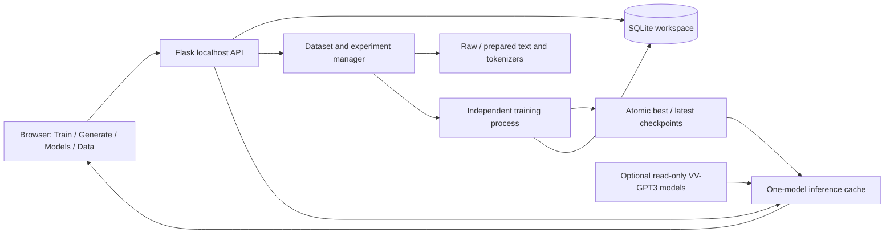

# Architecture and engineering notes

VV-GPT is a single-user local Python application. There is no external inference service, frontend build system or hosted database. The browser uses vanilla JavaScript, CSS and a canvas chart. Flask serves the page and a small JSON API. PyTorch performs both training and generation.

## Source map

| File | Responsibility |
| --- | --- |
| `launcher.py`, `VV_GPT4.command` | Identify/reuse this checkout's server, find a loopback port and open the browser. |
| `app.py` | Request validation, dataset/run/sample APIs, local request boundaries and generation lock. |
| `vvgpt/config.py` | Optional machine-local legacy model discovery. |
| `vvgpt/store.py` | SQLite connections, transactions and workspace directories. |
| `vvgpt/lab.py` | Dataset preparation, configuration validation, worker lifecycle, model discovery and generation. |
| `vvgpt/model.py` | Classic and revised decoder-only Transformers plus sampling. |
| `vvgpt/worker.py` | Train/evaluate loop, optimization, checkpointing, pause and recovery. |
| `vvgpt/data.py`, `tokenizer.py`, `evaluation.py` | Unicode preparation, train-only BPE and byte-normalized scoring. |
| `vvgpt/objectives.py` | Optional bounded token-unlikelihood loss. |
| `templates/`, `static/` | Responsive interface, native dialogs and canvas chart. |
| `scripts/` | Explicit research drivers, verification, demo installation and report/capture tools. |

## Model choices

The classic model retains the original learned-position, normalization and feed-forward arrangement for compatible checkpoint loading. The revised model uses RMSNorm, rotary position embeddings and bias-free SwiGLU blocks with approximately matched feed-forward parameter budget. The revised bundle was tested together; the study does not isolate the contribution of each component.

The optional compact tokenizer is a byte-level BPE fitted only on the training partition and embedded in the checkpoint. It round-trips previously unseen Unicode. Original GPT-2 tokenization is supported without loading pretrained GPT-2 weights. Architecture/context/vocabulary are inherited during continuation; incompatible parameters are never silently adapted.

## Data and experiment lifecycle

An import creates raw/prepared UTF-8 files and a preparation report, then records its ID, size and SHA-256 in SQLite. Normal imports use chronological 80/10/10 partitions. Research imports carry explicit whole-record boundaries and hashes. Fitted tokenizers and partitions are checked against their source fingerprints.

Starting a run validates the complete configuration and reserves the sole training slot inside a SQLite write transaction. A separate Python process owns training. The server can close and reopen without killing that worker. Reconciliation marks vanished workers as interrupted, preserving saved state.

AdamW uses separate decay groups, warmup/cosine learning rate, optional gradient accumulation, clipping and early stopping. Evaluation uses fixed sampled batches with dropout disabled. Validation alone selects best weights. Test scoring happens after selection; normal app scoring caps the held-out text at 8,000 characters.

## Checkpoints and recovery

- `initial.pt`: run-local copy of the source weights for a continued run.
- `best.pt`: weights/config/tokenizer selected by lowest validation loss, saved immediately through atomic replacement.
- `latest.pt`: resumable model, optimizer, schedule step and CPU/device RNG state.
- `summary.json`: parameter/token counts, device, timings and held-out measurement.
- `worker.log`: process diagnostics.

Continued runs score and save their initial weights before any update. They must improve on that score to replace the best model. Recovery handles a crash between the separate best/latest writes. CPU interrupted/uninterrupted parity is regression-tested; accelerator or cross-version determinism is not claimed.

The optional release demo is imported as a completed recorded run. It includes best weights, summary and original measurement rows, with a `release_demo` marker. It excludes training text, optimizer state and parent weights. It can generate or seed a new experiment, but cannot resume its original training process.

## Local request boundaries

The server binds to loopback, validates Host and Origin, requires a random per-start token for mutations, limits uploads to 16 MiB and sets a restrictive content-security policy. Generation requests are serialized with a lock and cache one loaded model. Run IDs resolve through the model registry; legacy checkpoint paths are checked against the configured directory.

PyTorch loads checkpoints with `weights_only=True`; only the known original configuration dataclass is allowlisted for inherited files. The demo installer checks the archive and checkpoint hashes, rejects unexpected archive members and validates state-dict compatibility before installing. This is not a sandbox for arbitrary untrusted checkpoint files.

Training and generation can still contend for accelerator resources. It is best to finish/pause training before timing generation. Flask is used as a local development server; internet/multi-user deployment is outside this release's scope.

## UI structure

A persistent four-destination navigation bar gives every core task an addressable hash route. Dialogs handle short setup/inspection tasks. Selection persists in localStorage, while durable experiment/sample data lives in SQLite. Native controls, visible focus, a skip link, text labels, reduced-motion behavior and keyboard chart inspection support accessibility. Automated responsive checks do not constitute a full assistive-technology audit.

Historical conversation/document tables remain in the storage schema from an earlier prototype, but the current application exposes only own-model workflows. See [the interface rationale](INTERFACE_REVISION.md) for the accepted design.
