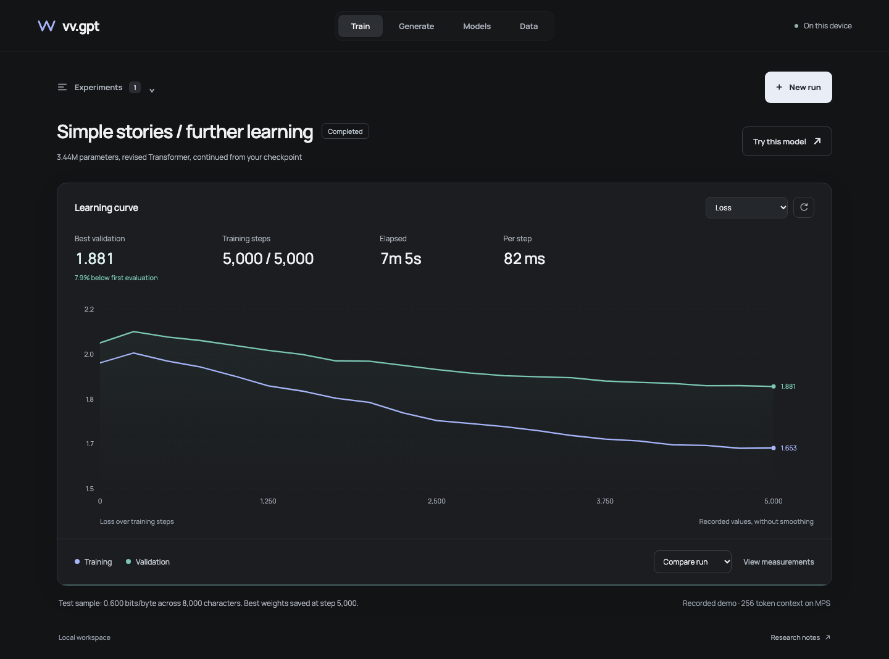

# VV-GPT: from a homemade Transformer to a usable research studio

**By Xavier Blake · Python, PyTorch, Flask, SQLite and JavaScript · Portfolio release 4.3.0**

## The project

VV-GPT began as a personal language-model project: build a Transformer, train it on real text, and make its weights usable through a local interface. Earlier versions already supported custom models, training, chat and a desktop launcher. This iteration asks a more specific question: **can the models Xavier already trained become better, with improvements that can actually be measured?**

The answer is qualified. Continued learning improved likelihood on public Shakespeare text; a revised Transformer bundle improved two controlled scratch runs; simple-story training produced more conventional sentences. The project also records the boundaries: repetition controls were inconsistent, private-chat continuation barely changed the score, and the story model still loses track of entities and causes.

## Starting from the original achievement

The public lineage runs through [homemade-gpt](https://github.com/XavierB100/homemade-gpt), [vv-gpt-mac](https://github.com/XavierB100/vv-gpt-mac), [vv-gpt2](https://github.com/XavierB100/vv-gpt2) and [vv-gpt3](https://github.com/XavierB100/vv-gpt3). The audited VV-GPT3 checkpoint families were approximately 30M, 51M and 30M parameters by their historical metadata; those counts exclude positional embeddings. The original source and launcher remain separate and preserved.

This version keeps compatible loading of those learned weights and adds isolated continuation. New architecture experiments start with new weights. It does not substitute downloaded foundation-model weights for the user's own models.

## Engineering work

**Reliable experiments.** Separate best and resumable checkpoints, atomic writes, optimizer/RNG restoration and protected step-zero continuation make the training process recoverable. Fixed evaluation batches, fingerprinted partitions and train-only tokenization make comparisons easier to inspect.

**Architecture with evidence.** RMSNorm, RoPE and SwiGLU were introduced as a selectable bundle motivated by published work. Two matched scratch seeds improved test bits/byte by about 5.5%. This is evidence for the tested bundle and dataset; it is not a component-by-component attribution or a general scaling claim.

**Usable local tooling.** One workspace now handles importing text, training, comparing curves, inspecting checkpoints and saving matched generation comparisons. A loopback-only Flask service and durable SQLite state keep the workflow self-contained. The launcher checks readiness and reuses the correct project instance.

**A clearer interface.** Iteration exposed that putting all functions in drawers made navigation awkward. The accepted design gives Train, Generate, Models and Data persistent destinations. A large learning chart remains the training focus; settings and detailed tables open only when needed. Mobile layouts, keyboard navigation and browser history were verified.

**A reproducible handoff.** The release includes a public example corpus, optional verified download of the project's 3.44M-parameter story model, real screenshots, recorded evidence and fresh-workspace browser checks. Private data and private-trained weights stay out of the public repository.

## Results in context

- Original Shakespeare continuation reduced external Hamlet bits/byte from **2.518 to 2.338**. Historical test performance also improved, with a disclosed prior-selection caveat.
- Revised scratch runs reduced test bits/byte from **2.775 to 2.624** and **2.759 to 2.606** at two seeds.
- The story continuation reduced a common reserved slice from **0.753 to 0.693** bits/byte. It still failed entity, goal or causal consistency in every one of the 16 inspected continuations.
- Private-chat continuation improved historical likelihood by only about **0.1%**. There is no substantiated claim of meaningful chat coherence improvement.

The [results document](RESULTS.md) links raw measurements, protocol, losing candidates and qualitative review. A lower loss is not itself proof of coherent conversation.

## What this demonstrates

The strongest portfolio story is the complete loop: implement a model, preserve and continue real checkpoints, build a usable training tool, measure proposed improvements, and report both gains and failures. The application makes the research inspectable instead of relying on a polished output sample alone.

Xavier supplied the original project, trained artifacts, goals and design direction. The 2026 engineering/research/interface revision was developed with AI coding and research assistance. The repository retains implementation, tests, protocol and evidence so the work can be assessed directly.

## Suggested portfolio description

> VV-GPT is my local language-model training studio, built on a series of homemade Transformer projects. It lets me train and continue my own models, inspect learning curves, and compare generated text. I added a revised Transformer architecture, recoverable training and a minimal research interface, then tested the changes against my existing checkpoints. The project includes a small public story model and documents both measured improvements and the coherence problems that remain.

Use [the screenshot gallery](GALLERY.md) for images and captions. Link to the repository and release as the runnable demonstration; the localhost address is not a public hosted demo.

## Where this release stops

The next substantive research step would be a fresh, predefined coherence evaluation and a small controlled data/compute study. More settings or another visual redesign are unlikely to settle that question. The project is paused at a documented portfolio milestone, with no new training scheduled.
