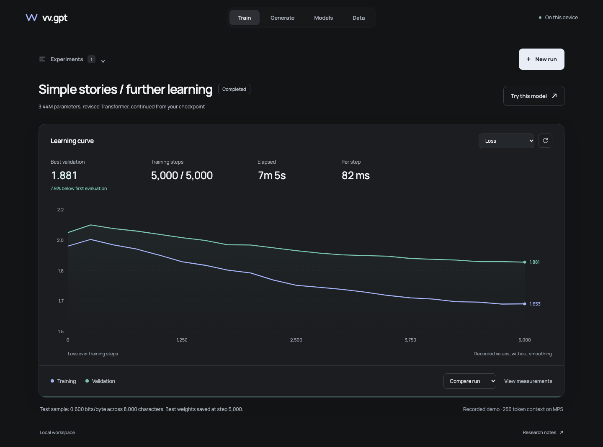
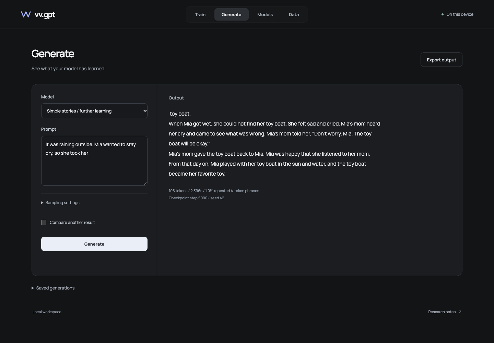
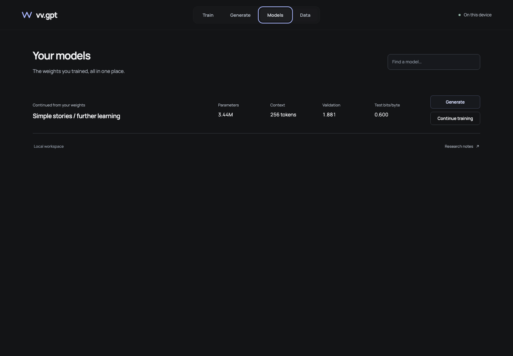
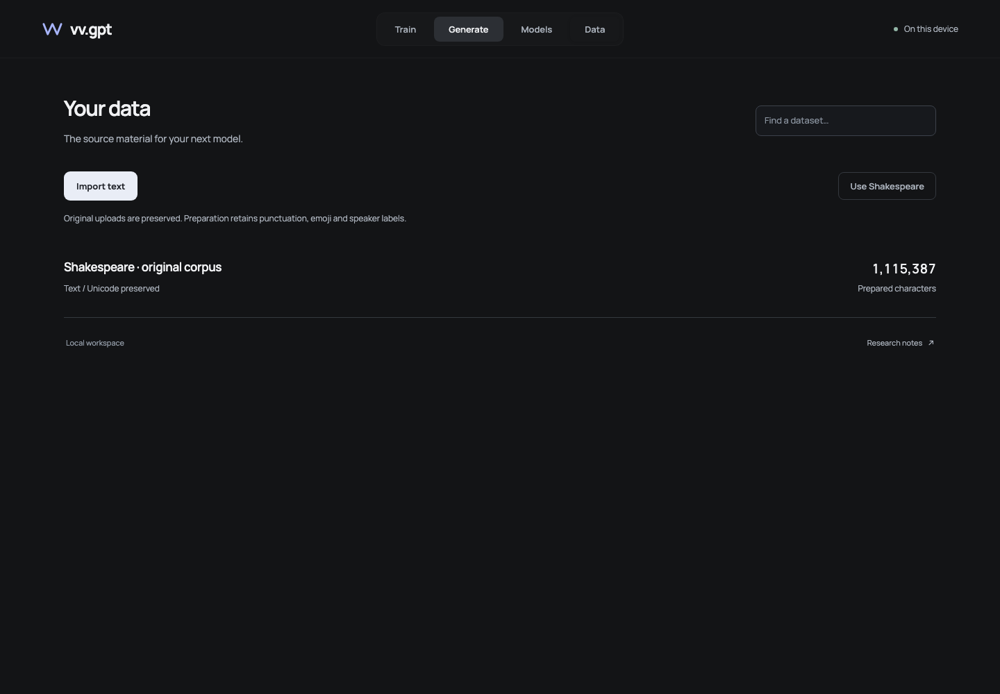
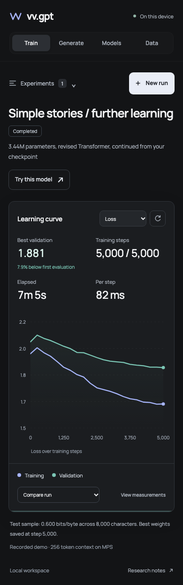
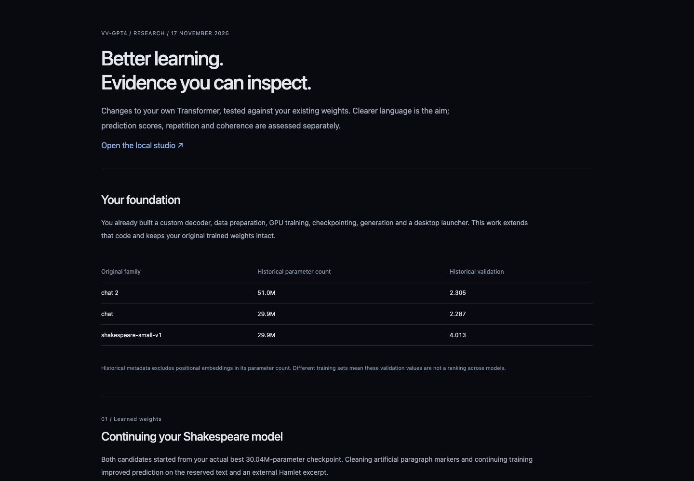

# Interface gallery

Captured from the running v4.3.0 interface using a separate public-demo workspace. The curves are original recorded measurements from the released story model. No private chat text, generated private samples or private weights appear here. These are screenshots, not design mockups.

## Train

**Portfolio caption:** A focused training workspace with persistent navigation, unsmoothed learning curves and the checkpoint's held-out score. The demo label distinguishes historical measurements from a current live run.

## Generate

**Portfolio caption:** Inspect the model's actual output alongside its seed, token count and repetition measurement. The fixed prompt and seed are recorded; the text still demonstrates the limitations of a small locally trained model.

## Models

**Portfolio caption:** A searchable library connects each checkpoint to generation or further learning, with parameter count, context and evaluation scope visible.

## Data

**Portfolio caption:** Import source text or start with a bundled example. Preparation preserves the original upload and reports the dataset used for a new experiment.

## Mobile

**Portfolio caption:** The same task navigation and training information adapt to a narrow screen. Release checks cover widths from 320 to 1440 pixels.

## Research report

**Portfolio caption:** Measured improvements and negative findings remain visible, with separate treatments of original-weight continuation, revised architecture and simple-story training.

Files can be reused directly in the owner's portfolio. Keep captions with their limitations; do not present generated text as reliable factual output or the local URL as a public hosted demonstration. Earlier `research-*` and `navigation-*` captures in this folder document previous iterations; the images linked above are the release gallery.
